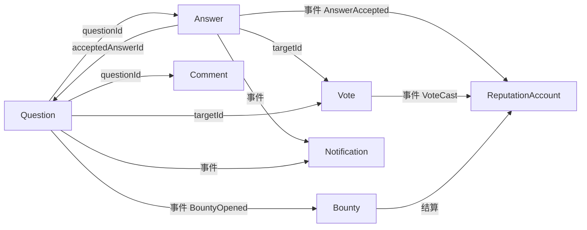

# 聚合识别清单（Aggregate Inventory）

> 判定标准：一个聚合 = 一个一致性边界。跨聚合只能靠事件或最终一致，不允许在一个事务里改两个聚合。

## Q&A 上下文

### A1. Question（聚合根）

| 项 | 内容 |
|---|---|
| 根实体 | `Question` |
| 内部对象 | `Title`（值对象）、`MarkdownBody`（值对象）、`Tags`（值对象集合）、`TagName` |
| 生命周期 | 提问创建 → 可编辑 → 可采纳一次 → 可软删除 |
| 关键不变式 | ① 标题 10–150 字；正文 10–2000 字 ② 标签 1–5 个且去重归一 ③ **最多只能有一个被采纳的答案，采纳后不可更改** ④ 只有提问者或课程管理者可采纳 ⑤ 已删除的问题不能再被回答/编辑/采纳 ⑥ 提问者只能删无回答的问题，管理者可删任意 |
| 引用 | `courseId`、`authorId`（只存 id，不持有对象） |

### A2. Answer（聚合根）

| 项 | 内容 |
|---|---|
| 根实体 | `Answer` |
| 内部对象 | `MarkdownBody` |
| 生命周期 | 提交 → 可编辑 → 可被认证 → 可软删除 |
| 关键不变式 | ① 正文 10–5000 字 ② 只有作者或课程管理者可编辑 ③ **教师认证只能打一次**（重复报 Conflict） ④ **被采纳的回答不能由作者本人删除**（防"先骗采纳再删"） ⑤ 问题已删除时不能提交回答 |
| 与其他聚合 | 通过 `questionId` 引用 Question，**不持有 Question 对象**——这是为了降低并发冲突 |

### A3. Vote（聚合根）

| 项 | 内容 |
|---|---|
| 根实体 | `Vote` |
| 内部对象 | `TargetType`（枚举：QUESTION / ANSWER） |
| 关键不变式 | ① 值只能是 +1 或 −1 ② **不能给自己的内容投票** ③ 同一个人对同一目标只有一票，改票按"新效果 − 旧效果"结算 |

### A4. Comment（聚合根）

| 项 | 内容 |
|---|---|
| 根实体 | `Comment` |
| 关键不变式 | ① 正文 1–1000 字 ② **只支持一层回复**（回复的回复被拒绝） ③ 回复必须与父评论挂在同一目标下 |

## Reputation 上下文

### A5. ReputationAccount（聚合根）

| 项 | 内容 |
|---|---|
| 根实体 | `ReputationAccount` |
| 内部对象 | —（两个余额字段：可用 / 冻结） |
| 关键不变式 | ① **声誉恒等于该用户全部账本流水之和**（对账任务校验） ② 冻结积分不能超过可用积分 ③ 积分变动必须为正数 |
| 一致性 | 账户变更与账本写入在同一事务；跨用户结算走事件 |

### A6. Bounty（聚合根）

| 项 | 内容 |
|---|---|
| 根实体 | `Bounty` |
| 内部对象 | `BountyStatus`（OPEN / AWARDED / EXPIRED） |
| 关键不变式 | ① 悬赏积分为正 ② 发起时冻结发起人的积分 ③ **只能结算一次**：采纳后发放，或到期退回 ④ 结算与状态流转必须在同一事务 |

### A7. Badge（实体）

| 项 | 内容 |
|---|---|
| 根实体 | 无独立聚合，挂在用户下 |
| 关键不变式 | 同一类型徽章对同一用户只发一次（唯一键） |

## Identity 上下文

### A8. User（聚合根）

| 项 | 内容 |
|---|---|
| 根实体 | `User` |
| 内部对象 | `UserStatus`、`Role` |
| 关键不变式 | ① 邮箱唯一 ② 密码满足策略（长度 + 复杂度） ③ 封禁用户不能登录 |

### A9. Course（聚合根）

| 项 | 内容 |
|---|---|
| 根实体 | `Course` |
| 内部对象 | `CourseMember`（成员 + `CourseRole`） |
| 关键不变式 | ① 课程内角色只有 TEACHER / TA / STUDENT ② 同一用户在同一课程只有一个角色 |

## Discovery 上下文

### A10. Notification（聚合根）

| 项 | 内容 |
|---|---|
| 根实体 | `Notification` |
| 内部对象 | `NotificationType` |
| 关键不变式 | ① 标题非空 ② 只有收件人本人能标记已读 ③ `sourceEventId` 唯一——同一事件不重复生成通知 |

## 聚合之间的关系

**注意**：箭头不代表对象引用，只表示"通过 id 或事件发生关系"。Question 与 Answer 之间是双向 id 引用，但**没有任何一个事务同时修改两者**。
